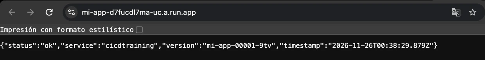
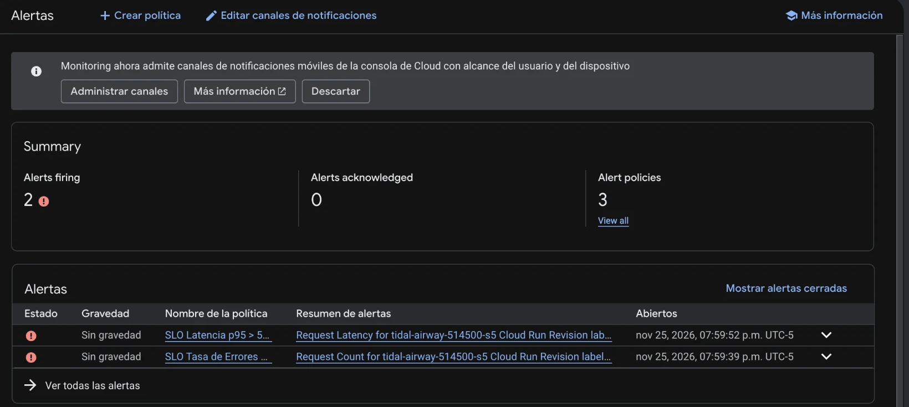
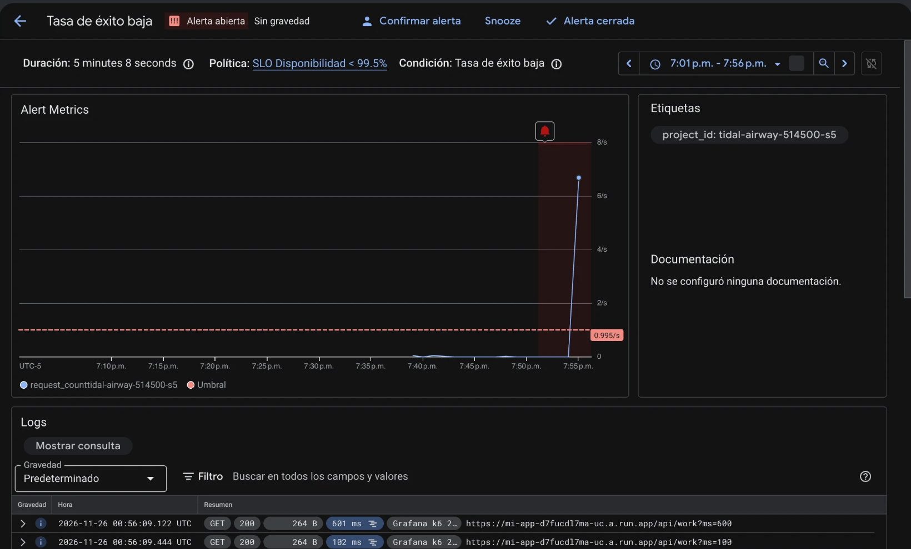
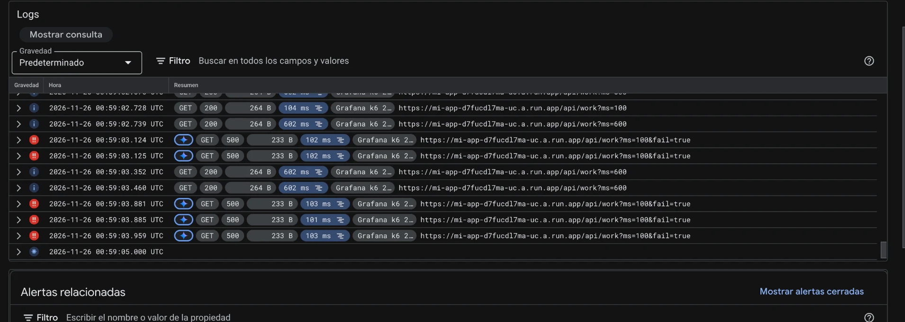
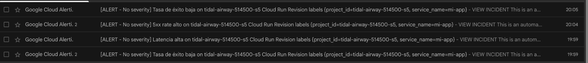
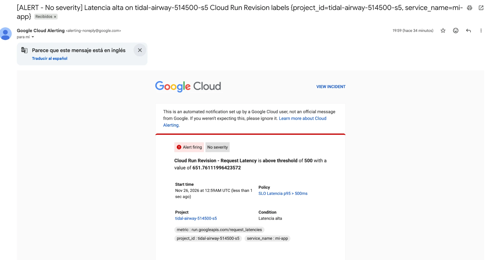
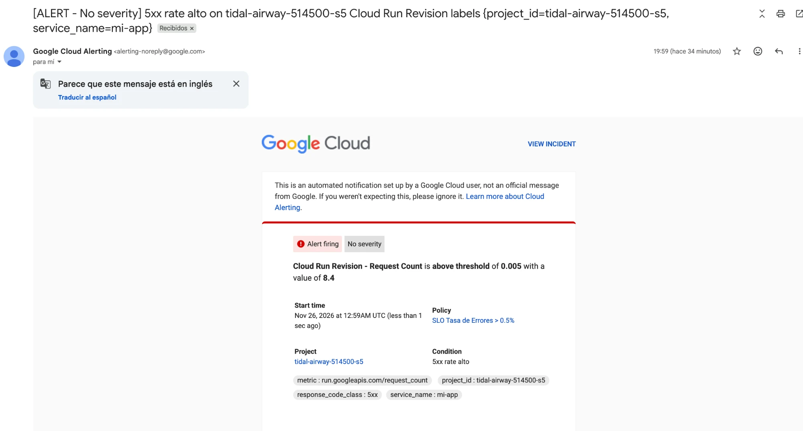
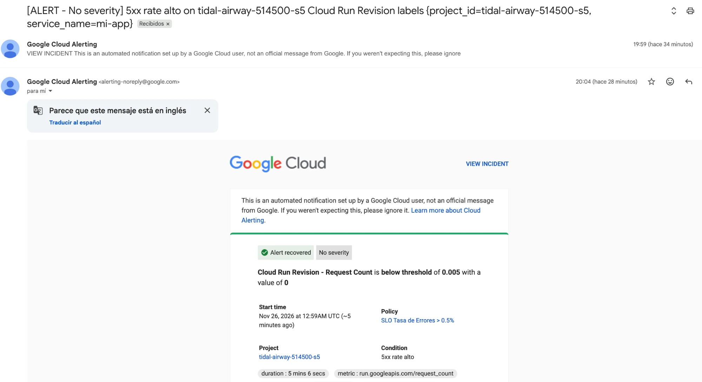
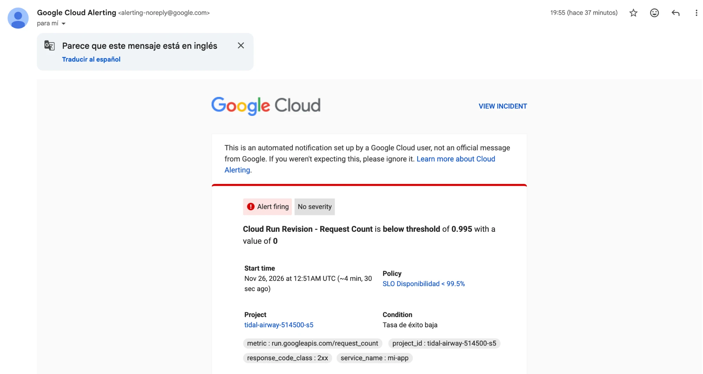
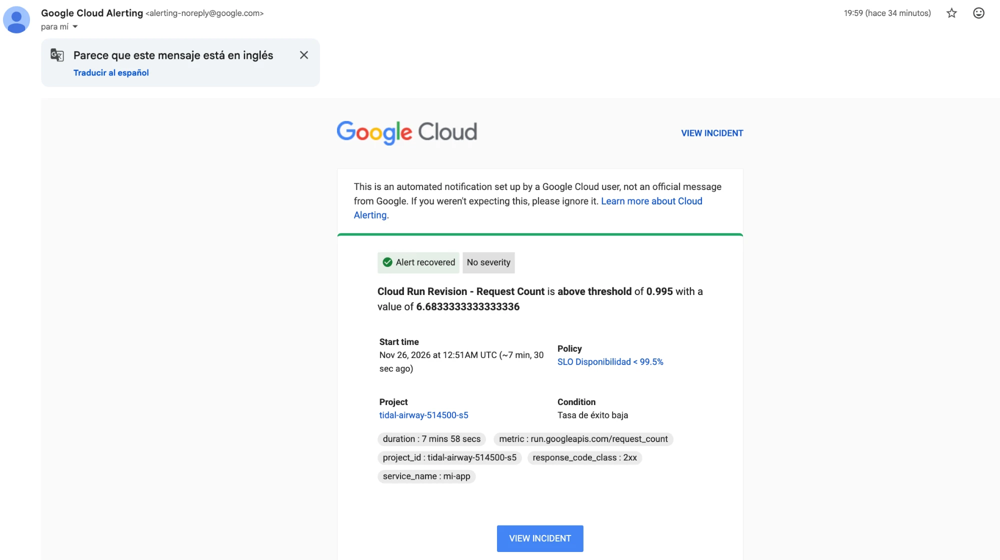

# Evidencias de la práctica

## 1. Pipeline y despliegue
- [Ejecuciones en GitHub Actions](https://github.com/GenesisDaniela/cicdtraining/actions)

Respuesta de la app en Cloud Run:

## 2. Prueba de carga con k6
- [Resumen de la prueba](k6-resultado.txt)

## 3. Alertas

Alertas de latencia y de tasa de errores disparadas durante la prueba:

Alerta de disponibilidad. Se abrió cuando casi no había tráfico, porque mide peticiones por segundo y no un porcentaje:

## 4. Registros

Errores 500 generados a propósito por k6:

## 5. Integración con Gemini
- [Análisis de los resultados](analisis-gemini.md)

## 6. Notificaciones por correo

Avisos recibidos:

Latencia alta:

Tasa de errores 5xx:

Tasa de errores recuperada:

Disponibilidad (con casi nada de tráfico, valor 0):

Disponibilidad recuperada:

